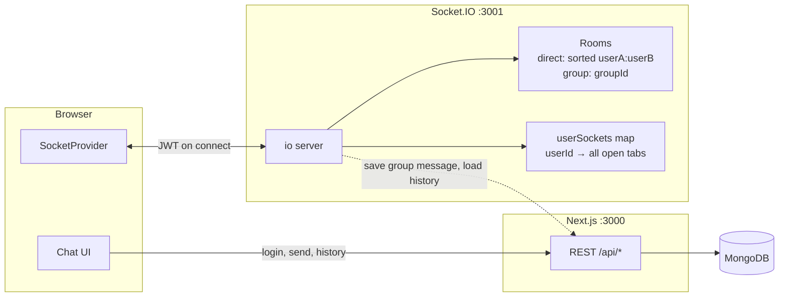
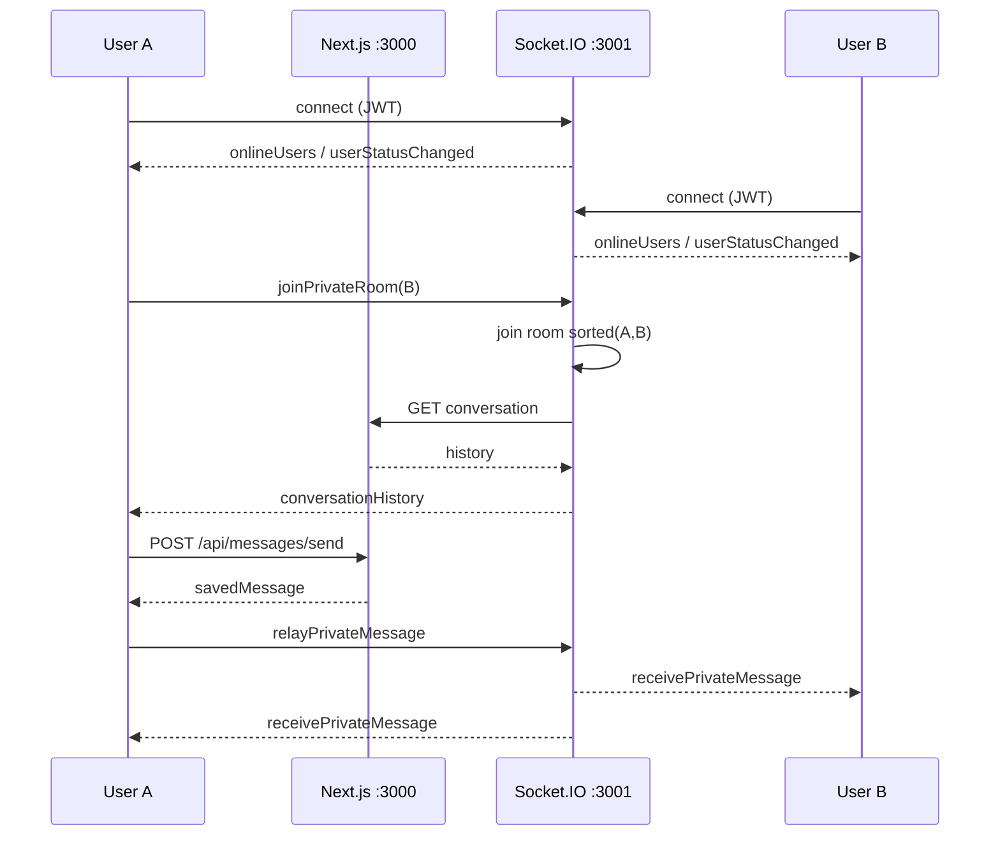
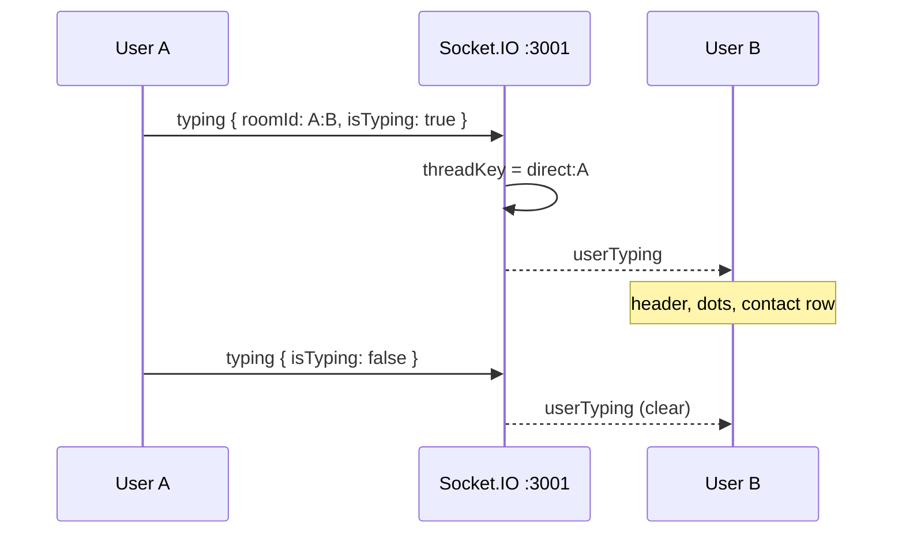

# Instant Messaging

Real-time chat app (Pulse): Next.js API/UI on port **3000**, Socket.IO presence and messaging on port **3001**.

## Stack

- Next.js 15 (Pages API + App Router)
- Socket.IO
- MongoDB
- JWT auth

## Features

- Sign up, log in, and stay signed in with JWT
- Add contacts by username
- Online / offline presence for contacts
- One-to-one chat: open a contact, load history, send in real time
- **New chat** picker: one person starts a DM; two or more creates a group automatically
- Groups list in the sidebar; reopen an existing group with the same members instead of duplicating it
- Group messages show the sender name and update live for every member
- New-message alerts: toast when you are in another chat, unread badge on the thread, and a count in the tab title
- Typing indicator: bouncing dots and “is typing…” in the open chat, header, and contact list
- Message requests when the other person does not have you as a contact
- Accept a request to add them and open the thread
- Decline a request to notify the sender and block further messages

## Setup

```bash
cd nextjs-api
npm install
```

Create `nextjs-api/.env.local` (this overrides `.env`):

```
MONGODB_URI=mongodb+srv://<user>:<password>@<cluster>.mongodb.net
MONGODB_DB=Cluster0
JWT_SECRET=<your-secret>
PORT=3000
SOCKET_PORT=3001
```

Use a live Atlas connection string. `mongodb+srv` hosts that no longer resolve will make every API route return 500.

Optional: `NEXT_PUBLIC_SOCKET_URL=http://localhost:3001` if the client should not use the default.

## Run

Both processes must be running or the UI will show socket connection errors and contacts will never appear online. After changing `backend/config/socket.ts`, restart `npm run dev:socket` — that process does not hot-reload.

```bash
cd nextjs-api

# terminal 1 — Next.js
npm run dev

# terminal 2 — Socket.IO
npm run dev:socket
```

Or start both:

```bash
npm run dev:all
```

- App: http://localhost:3000 (redirects to `/login`)
- Socket: http://localhost:3001

## How the WebSocket works

The browser talks to two processes. REST on **:3000** owns auth and persistence. Socket.IO on **:3001** owns presence, rooms, and live delivery. A message is saved over HTTP first, then relayed on the socket so every tab for that user updates.



On connect, `SocketProvider` opens `io(SOCKET_URL, { auth: { token } })`. The server verifies the JWT, records the socket under that user, and broadcasts who is online. Opening a chat joins a room; sending or typing is then fan-out from that room plus a direct emit to every socket for the other person (React Strict Mode and extra tabs mean one user can have more than one socket).



If B does not have A as a contact, the same send still saves the message. The socket delivers `strangerMessageRequest` to B instead of opening their chat. Accept/deny goes back out as `messageRequestResolved`.

Typing never hits Mongo. A emits `typing`; the server rewrites the key to `direct:<typerId>` (or keeps `group:<groupId>`) and sends `userTyping` to the other sockets. The UI looks that key up in the open thread and the contact list.



Groups follow the same pattern: create over REST, `announceGroup` / `groupCreated` to each member, `joinGroupRoom(groupId)`, then `relayGroupMessage` → `receiveGroupMessage`.

| Client emit | Server does | Clients receive |
| --- | --- | --- |
| connect + JWT | map socket → user, mark online | `onlineUsers`, `userStatusChanged` |
| `joinPrivateRoom` | join `sorted(A,B)`, load history | `conversationHistory` |
| `relayPrivateMessage` | room + `emitToUser` | `receivePrivateMessage` or `strangerMessageRequest` |
| `typing` | rewrite thread key, fan-out | `userTyping` |
| `announceGroup` / `relayGroupMessage` | emit to each member | `groupCreated` / `receiveGroupMessage` |
| disconnect | drop socket; offline after 5s if none left | `userStatusChanged` |

`ts-node` does not hot-reload. Restart `npm run dev:socket` after changing `backend/config/socket.ts`.

## App workflow

### 1. Create an account or sign in

1. Open http://localhost:3000. You land on `/login`.
2. New users go to `/signup`, then are signed in.
3. Returning users sign in with email or username plus password.
4. A successful login stores the JWT and opens `/chat-room`.

### 2. Connect and see who is online

1. The chat room connects to Socket.IO with the JWT.
2. Your header shows **Connected** when the socket is up.
3. Contacts show **Online** or **Offline** from live presence, not a page refresh.

### 3. Add someone and start a direct chat

1. In **Add someone**, enter an existing username and submit.
2. They appear under **Chats**. Adding them is one-way — they do not get you automatically.
3. Click a contact, or use **New chat** and pick one person, to open the thread.
4. History loads, and new messages appear live.
5. Type in the composer and send. Your bubble appears immediately; theirs appears on their side if they already have you as a contact.
6. If a message arrives while you are in another chat, a toast appears, that thread gets an unread badge, and the browser tab title shows the count. Click the toast or the thread to open it.
7. While the other person is typing, you see bouncing dots and “is typing…” in the thread. Their contact row also shows Typing...

### 4. Start a group from New chat

1. Click **New chat** in the sidebar.
2. Select one contact and **Start chat** to open a direct thread.
3. Select two or more contacts. The button becomes **Create group** — Pulse names the group from those usernames and adds you as a member.
4. The group appears under **Groups** for everyone in it (live if they are online, or the next time they open the chat room).
5. Open the group to send messages. Each bubble shows who sent it.
6. Choosing the same set of people again reopens that group instead of creating a second one.

### 5. Message request (stranger)

Used when **you** have them as a contact, but **they** do not have you.

1. You send a message as usual. You still see your own bubble, plus **Waiting for them to accept your message**.
2. They get a modal: message from a stranger, with username and a preview. The chat does not open yet.
3. **Accept** — they are added to the recipient’s contacts, the thread opens, and waiting messages appear.
4. **Decline** — they are not added. You see **They declined your message request**, and further sends are blocked until they add you themselves.
5. If they are offline when you send, the request is stored. The modal appears the next time they open the chat room.

### 6. Sign out

Use **Log out** in the header. The socket disconnects and you return to login.

## API (high level)

| Area | Routes |
| --- | --- |
| Auth | `POST /api/signup`, `POST /api/login`, `GET /api/auth`, `POST /api/auth/logout`, `POST /api/auth/refresh-token` |
| Contacts | `/api/contacts/get-all-contact`, `add-contact`, `remove-contact`, `update-name` |
| Message requests | `GET /api/contacts/message-requests`, `POST /api/contacts/respond-message-request` |
| Private messages | `/api/messages/send`, `conversation`, `inbox` |
| Groups | `POST /api/messages/group/create-group-chat`, `GET /api/messages/group/fetch-all-messages`, `POST /api/messages/group/add-message-to-group` |

Queries use `getDb()` and `MONGODB_DB`. Collections: `imUsers`, `contacts`, `messages`, `messageRequests`, `groupChats`, `groupChatsMessages`.

Private send still requires the **sender** to have the receiver as a contact. If the receiver does not have the sender, the API saves the message, creates or updates a pending `messageRequests` document, and the socket delivers a request instead of opening their chat.

Creating a group requires you plus at least two other people (the usernames you selected in **New chat**). The creator is added automatically.

## Project layout

```
nextjs-api/
  src/app/                      # login, signup, chat-room UI
  pages/api/                    # REST handlers
  backend/config/mongodb.ts
  backend/config/socket.ts
  backend/context/              # contacts + shared socket provider
  backend/components/Chat/      # chat pane, group pane, New chat + stranger modals
  backend/utils/ids.ts          # ID normalization
  backend/utils/groups.ts       # group / group-message serialization
  server.ts                     # Socket.IO process (port 3001)
```
